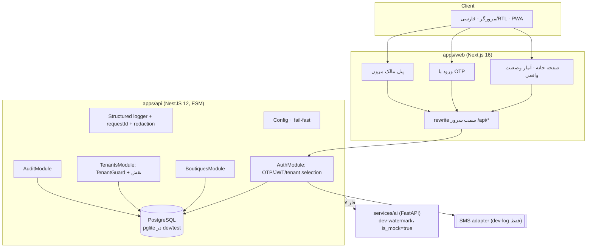

# معماری BridalOS (نسخه فعلی)

## اصول

1. **Modular monolith** برای هسته تجاری؛ سرویس AI جدا و اختیاری.
2. مرز tenant در **لایه برنامه** (همه کوئری‌ها با شناسه کاربر/مزون محدود می‌شوند) و
   **RLS** به‌عنوان لایه دوم در production.
3. تاریخ‌ها همیشه ISO-8601/UTC در ذخیره‌سازی؛ شمسی فقط در نمایش.
4. پول همیشه عدد صحیح ریال؛ تومان فقط در نمایش.
5. هر قابلیت بیرونی (پیامک، AI، پرداخت) پشت **آداپتور** با صریح‌ترین وضعیت ممکن.

## اجزا

## مدل داده (فاز فعلی)

| جدول | نقش | کلیدهای مهم |
| --- | --- | --- |
| `users` | هویت سراسری با شماره موبایل | `phone` یکتا (E.164 داخلی `09xxxxxxxxx`) |
| `boutiques` | مزون/tenant | `slug` یکتا، `owner_user_id`، `status` |
| `memberships` | نقش کاربر در مزون | یکتای (`user_id`,`boutique_id`)، `revoked_at` |
| `otp_challenges` | کد یکبارمصرف | `code_hash` (HMAC)، `attempts`، `expires_at` |
| `audit_logs` | رخدادهای حساس | `actor_user_id`، `tenant_id`، `request_id`، `metadata` |

جزئیات ستون‌ها: [`../product/data-dictionary.md`](../product/data-dictionary.md).

## مرزهای اعتماد

- **مرورگر** هرگز راز ندارد؛ فقط توکن کوتاه‌عمر در `sessionStorage` (بدهی مستند).
- **API** تنها منبع حقیقت مجوز است؛ UI مخفی‌کردن دکمه هیچ ارزش امنیتی ندارد.
- ادمین پلتفرم: فعلاً فقط از طریق `users.platform_role` شناسایی می‌شود؛ مسیر مدیریت
  اختصاصی در فاز ۱۵ ساخته می‌شود.
- سرویس AI هیچ دسترسی مستقیم به دیتابیس اصلی ندارد (در فاز ۷ با صف/توکن محدود می‌شود).

## جریان درخواست (نمونه: ثبت مزون)

1. `POST /api/v1/boutiques` با `Authorization: Bearer <jwt>`.
2. `JwtAuthGuard` توکن را با HS256 بررسی می‌کند؛ شناسه کاربر در AsyncLocalStorage ثبت
   می‌شود (برای لاگ).
3. `BoutiquesService.create` در یک **تراکنش**: درج مزون + عضویت `boutique_owner`.
4. `AuditService` رخداد `boutique.created` را با `request_id` ثبت می‌کند.
5. پاسخ ۲۰۱ با `status: draft`؛ توکن فعلی فعال‌سازی نمی‌شود؛ کلاینت باید
   `POST /api/v1/auth/tenant` را صدا بزند (رفتار صریح و تست‌شده).
